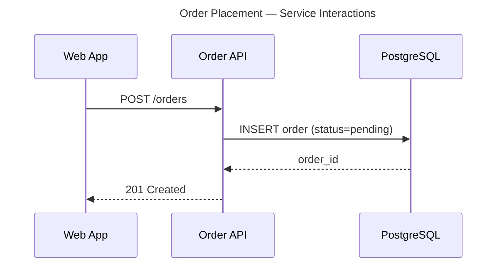

# Technical diagramming

A diagram is documentation that rots faster than prose, because nobody diffs an image. Write the source in text, render it in CI, and treat the rendered file as a build artifact.

## 1. Settle four questions before picking a tool

1. **Audience** — engineers (detail is fine), leadership (one level of abstraction only), auditors (controls and boundaries must be explicit).
2. **Purpose** — living documentation, a one-off for a deck, an ADR illustration, or a runbook flow.
3. **Lifecycle** — changes often (diagram-as-code, no exceptions) or frozen after one review (Draw.io is acceptable).
4. **Destination** — GitHub/GitLab README (Mermaid renders natively), Confluence (Mermaid or PlantUML plugin), a slide deck (SVG/PNG export), or a Draw.io canvas someone else will edit.

## 2. Pick the tool

| Diagram | Primary | Secondary |
|---|---|---|
| Flowchart, sequence, state, class, ERD | Mermaid | PlantUML |
| Gantt, mind map | Mermaid | PlantUML |
| Deployment, complex UML, network (nwdiag) | PlantUML | Draw.io |
| C4 across multiple levels | Structurizr DSL | PlantUML C4 |
| Cloud/Kubernetes with vendor icons | Diagrams (Python) | PlantUML + stdlib icons |
| Presentation-grade, pixel-positioned | Draw.io XML | — |

Default to Mermaid. It renders in-place on GitHub and GitLab with no build step, which means the diagram is visible in review. Reach past it when you need UML rigour, vendor icons, or a model that drives several views.

**Structurizr exports `plantuml`, `mermaid`, `dot`, `ilograph`, `json`, `theme`, and `websequencediagrams` — there is no Draw.io export format.** To land a Structurizr model in Draw.io, go through PlantUML and import the rendered SVG.

## 3. Write the source with the metadata attached

Every source file carries: a title visible in the render, a legend if colour or line style means anything, author/date/related-ADR in comments, and an explicit scope boundary.



Line breaks inside a label are `<br/>`, not `\n`. Mermaid renders a literal backslash-n in most versions.

## 4. Render and look at it

```bash
npx -y @mermaid-js/mermaid-cli -i docs/diagrams/src/context.mmd \
  -o docs/diagrams/rendered/context.svg
```

Auto-layout makes bad choices — crossed edges, labels outside their boxes, nodes stacked off-canvas. Open the output before committing. This is the step people skip and it is the reason most generated diagrams are unreadable.

For PlantUML and Python Diagrams commands, plus the source patterns for each diagram type, see `references/patterns.md`.

## 5. Keep source and render in the repo

```text
docs/diagrams/
├── src/                    # committed, reviewed
│   ├── system-context.mmd
│   ├── deployment.puml
│   └── c4-workspace.dsl
└── rendered/               # generated; commit or let CI produce it
    ├── system-context.svg
    └── deployment.svg
```

Pick one and be consistent: either commit rendered output (so the README works on a fresh clone) or generate it in CI (so it cannot go stale). Committing it *and* generating it produces merge conflicts in binary-ish files.

The CI recipe in `references/patterns.md` verifies the committed render matches the source rather than pushing a commit back to the PR branch — that pattern works on forks, needs no write permissions, and fails loudly when someone edits the source without re-rendering.

## 6. Converting between formats

```bash
# Any diagram-as-code → Draw.io: render to SVG, then File → Import in Draw.io
npx -y @mermaid-js/mermaid-cli -i diagram.mmd -o diagram.svg
java -jar plantuml.jar -tsvg diagram.puml

# Structurizr → PlantUML → SVG → Draw.io
structurizr-cli export -workspace workspace.dsl -format plantuml/c4plantuml
java -jar plantuml.jar -tsvg *.puml
```

Draw.io imports SVG as a single image by default. Use **Extras → Edit Diagram** or the import dialog's "import as shapes" option to get editable objects, and expect grouping and text to need cleanup either way.

Going the other direction — Draw.io XML to diagram-as-code — there is no converter that produces maintainable output. Recreate it by hand with the original open for reference, verify the render matches, then move the `.drawio` file to an `archive/` directory.

## 7. Check before committing

- [ ] Title is visible in the rendered output, not just the filename.
- [ ] Scope boundary is explicit — what is inside the system and what is external.
- [ ] Every arrow is labelled with a protocol, port, or relationship.
- [ ] Arrows point the way data or dependency flows.
- [ ] A legend explains any colour or line-style semantics.
- [ ] Author, date, and related ADR/ticket are in source comments.
- [ ] Text is legible at 100% zoom — nothing under 10px.
- [ ] It matches the system as it is today, or is labelled as a target state with a date.
- [ ] Source is committed; the render exists and has been looked at.

## Output format for diagram reviews

```markdown
## Diagram review

- Verdict: ready / needs changes
- Tool fit: <right tool for the type, lifecycle, and destination>
- Readability: <layout, label density, font size>
- Completeness: <unlabelled edges, missing boundary, absent legend>
- Accuracy: <matches the system; aspirational content marked>
- Maintainability: <source committed, render reproducible>

## Required changes
- `docs/diagrams/src/<file>` — <what to change and why>
```

## Pitfalls

1. **`\n` in a Mermaid label** — use `<br/>`; the backslash renders literally.
2. **Assuming Structurizr exports Draw.io** — it does not. Route via PlantUML → SVG.
3. **Screenshots of diagrams in docs** — cannot be diffed, searched, or updated.
4. **Unlabelled arrows** — a bare line between two boxes tells the reader nothing.
5. **Colour with no legend** — red means "critical" to you and "deprecated" to the next reader.
6. **Aspirational diagrams that look current** — label the target state and date it.
7. **Draw.io XML as source of truth when code would do** — the diff is unreviewable.
8. **Several diagrams in one source file** — one diagram, one file.
9. **Committing a render without looking at it** — auto-layout failures ship silently.
10. **A CI job that pushes renders back to the PR branch** — breaks on forks, needs write permissions, and races with the author's own pushes. Verify instead.

## References

- `references/patterns.md` — source patterns for each diagram type, rendering commands, CI, and the Draw.io XML skeleton and palette.
- [Mermaid documentation](https://mermaid.js.org/intro/)
- [PlantUML language reference](https://plantuml.com/guide)
- [Structurizr DSL reference](https://docs.structurizr.com/dsl/language)
- [Diagrams (Python)](https://diagrams.mingrammer.com/)
- [C4 model](https://c4model.com/)
