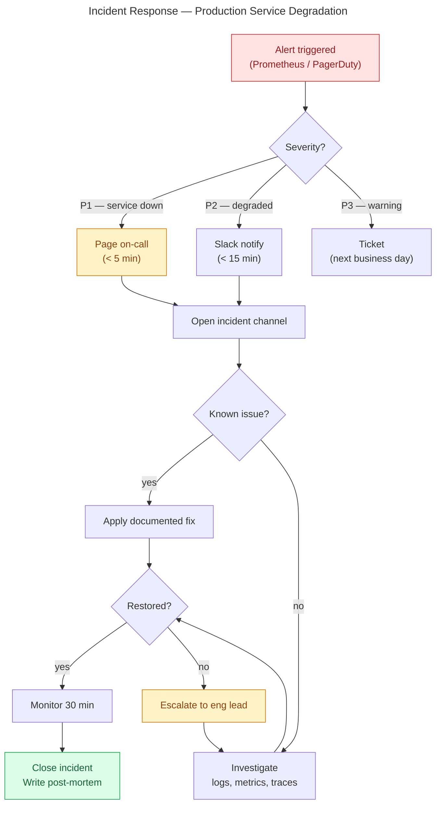
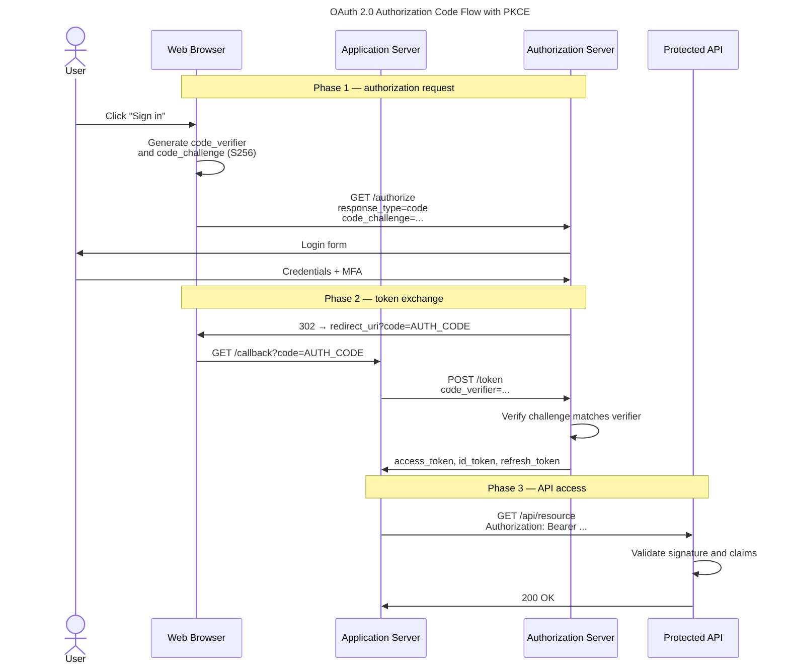
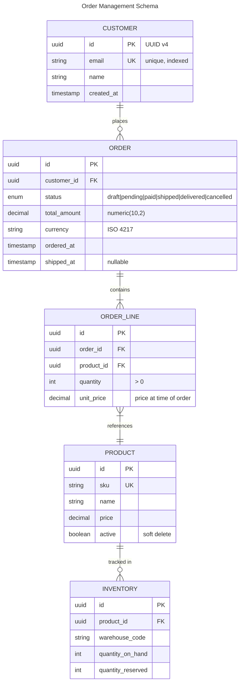
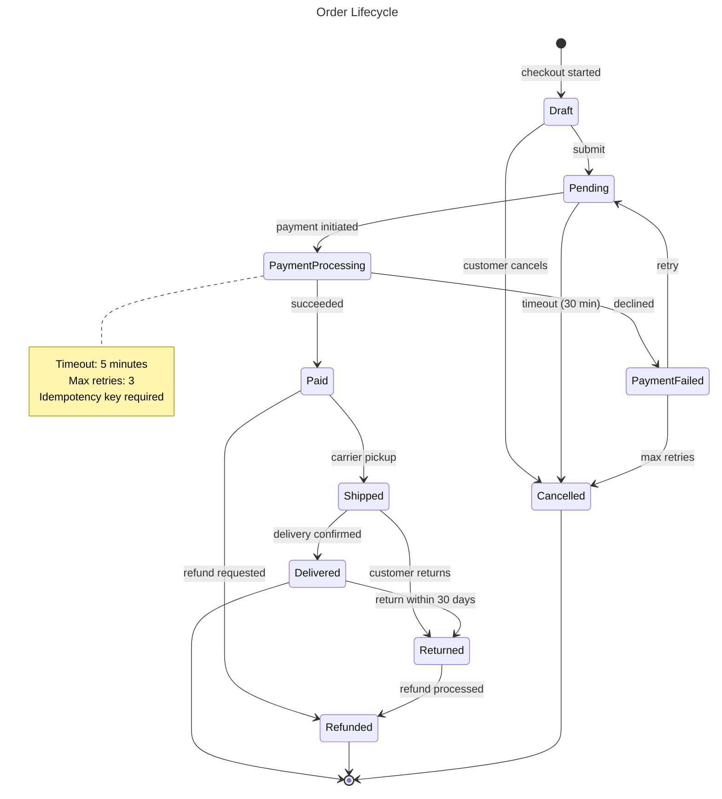
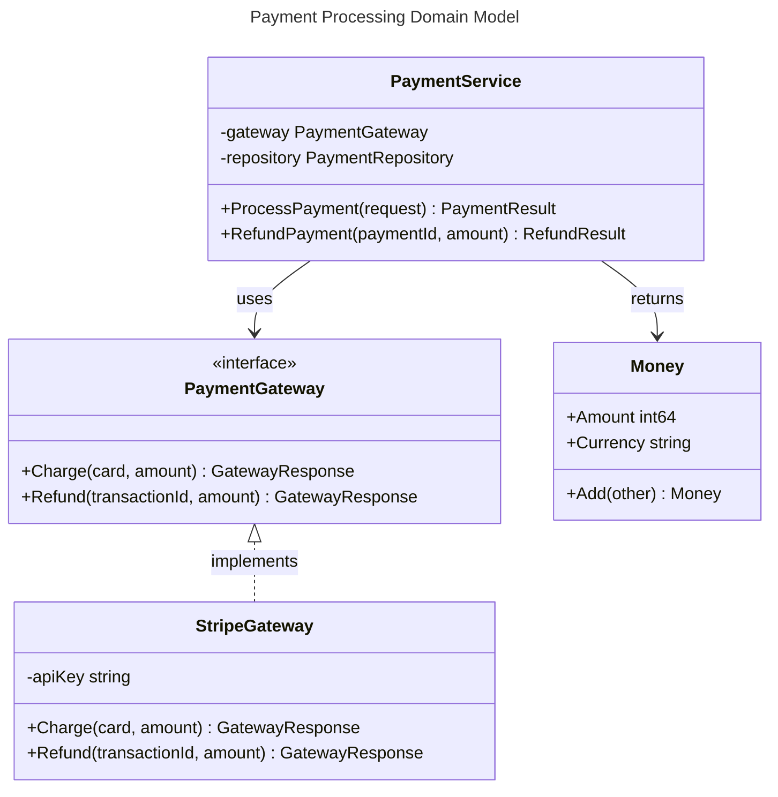
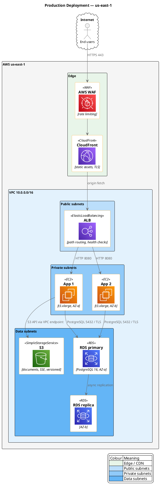
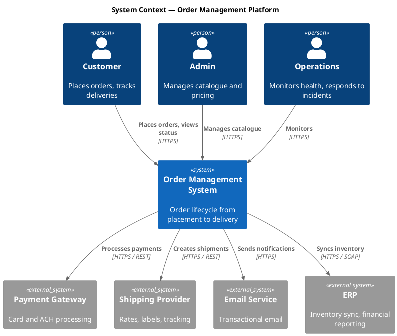

# Diagram patterns

Source patterns, rendering commands, CI, and Draw.io reference material.

## Tool profiles

### Mermaid

Renders natively in GitHub, GitLab, and most wikis, so the diagram is visible
in code review with no build step. Layout control is limited and the shape
library is small.

Extension: `.mmd` (or `.mermaid`).

```bash
npx -y @mermaid-js/mermaid-cli -i diagram.mmd -o diagram.svg
npx -y @mermaid-js/mermaid-cli -i diagram.mmd -o diagram.png -t default -w 2400
```

Line breaks in labels are `<br/>`. A literal `\n` renders as backslash-n.

### PlantUML

Widest diagram-type coverage (full UML, C4, network, Gantt, wireframes) and
vendor icon libraries. Needs a JVM, and auto-layout gets unpredictable on large
graphs.

Extension: `.puml`.

```bash
java -jar plantuml.jar -tsvg diagram.puml
java -jar plantuml.jar -tpng -Sdpi=300 diagram.puml

# No local JVM required
docker run --rm -v "$(pwd):/data" plantuml/plantuml -tsvg /data/diagram.puml
```

### Structurizr DSL

Model the system once, render several views from it. C4 only.

Extension: `.dsl`.

```bash
# Local web UI with live preview on :8080
docker run -it --rm -p 8080:8080 \
  -v "$(pwd)/workspace":/usr/local/structurizr \
  structurizr/lite

# Headless export
docker run --rm -v "$(pwd)":/usr/local/structurizr \
  structurizr/cli export -workspace workspace.dsl -format plantuml/c4plantuml
```

Export formats: `plantuml`, `plantuml/c4plantuml`, `plantuml/structurizr`,
`mermaid`, `dot`, `ilograph`, `json`, `theme`, `websequencediagrams`, and
custom templates. **There is no Draw.io export.** Route through PlantUML and
import the rendered SVG.

### Diagrams (Python)

Programmatic generation with official AWS/Azure/GCP/Kubernetes icons. Can be
driven from Terraform state or live manifests. Layout is Graphviz, so you
influence it rather than control it.

Extension: `.py`.

```bash
pip install diagrams          # also needs graphviz on the system
python architecture.py
```

Output format is whatever the script sets — `outformat="svg"` works directly,
there is no PNG-only limitation.

### Draw.io XML

Pixel-level control, the largest shape library, and the format non-technical
stakeholders can edit themselves. The XML is effectively unreviewable in a PR
and small visual edits produce large diffs.

Extension: `.drawio` (or `.xml`).

Edit in the desktop app, at <https://app.diagrams.net/>, or through the VS Code
"Draw.io Integration" extension.

## Mermaid patterns

### Flowchart — runbook



`<` and `>` must be entity-escaped (`&lt;`, `&gt;`) inside labels — Mermaid
parses labels as HTML and a raw `<` truncates the text.

### Sequence — OAuth 2.0 with PKCE



### ERD



### State machine



### Class diagram



## PlantUML patterns

### Deployment with AWS icons



`!include <awslib/...>` pulls from the PlantUML standard library bundled with
the jar. On an air-gapped host, vendor the stdlib and set `-DPLANTUML_LIMIT_SIZE`
and the include path explicitly. Do not combine `!theme` with the AWS library —
theme styling overrides the sprite colours.

### C4 system context



Include only the C4 level you are drawing. Including `C4_Context` and
`C4_Container` together works but pulls in macros you are not using.

## Structurizr DSL

Model once, render several views.

```dsl
// Author: Architecture Team | Related: ADR-001
// Preview: docker run -it --rm -p 8080:8080 -v "$(pwd)":/usr/local/structurizr structurizr/lite
// Export:  structurizr-cli export -workspace workspace.dsl -format plantuml/c4plantuml

workspace "Order Management Platform" "C4 model for the order management system" {

    model {
        customer = person "Customer" "Places orders, tracks deliveries" "External"
        admin = person "Admin User" "Manages products and pricing" "Internal"

        orderSystem = softwareSystem "Order Management System" "Full order lifecycle" {
            webApp     = container "Web Application" "Customer SPA" "React / TypeScript" "Browser"
            adminApp   = container "Admin Dashboard" "Internal UI" "React / TypeScript" "Browser"
            apiGateway = container "API Gateway" "Routing, rate limiting, authn" "Envoy" "Gateway"
            orderSvc   = container "Order Service" "Order lifecycle and state machine" "Go" "Service"
            paymentSvc = container "Payment Service" "Payment processing" "Go" "Service"
            notifySvc  = container "Notification Service" "Email and SMS" "Go" "Service"
            orderDb    = container "Order Database" "Orders and customers" "PostgreSQL 16" "Database"
            queue      = container "Message Queue" "Async events" "RabbitMQ" "Queue"
            cache      = container "Cache" "Sessions and query cache" "Redis" "Cache"
        }

        stripe   = softwareSystem "Stripe" "Payment processing" "External"
        sendgrid = softwareSystem "SendGrid" "Email delivery" "External"

        customer -> orderSystem "Places and tracks orders" "HTTPS"
        admin -> orderSystem "Manages catalogue" "HTTPS"
        orderSystem -> stripe "Processes payments" "HTTPS"
        orderSystem -> sendgrid "Sends notifications" "HTTPS"

        customer -> webApp "Uses" "HTTPS"
        admin -> adminApp "Uses" "HTTPS"
        webApp -> apiGateway "API calls" "HTTPS / JSON"
        adminApp -> apiGateway "API calls" "HTTPS / JSON"
        apiGateway -> orderSvc "Routes" "gRPC"
        apiGateway -> cache "Session lookup" "RESP / TLS"
        orderSvc -> paymentSvc "Initiates payment" "gRPC"
        orderSvc -> orderDb "Reads and writes" "PostgreSQL / TLS"
        orderSvc -> queue "Publishes events" "AMQP"
        paymentSvc -> stripe "Charges cards" "HTTPS"
        queue -> notifySvc "Delivers events" "AMQP"
        notifySvc -> sendgrid "Sends email" "HTTPS"
    }

    views {
        systemContext orderSystem "SystemContext" {
            include *
            autolayout lr
            description "External users and systems"
        }

        container orderSystem "Containers" {
            include *
            autolayout lr
            description "Internal services and data stores"
        }

        styles {
            element "Person"          { shape Person background #08427B color #FFFFFF }
            element "External"        { background #999999 color #FFFFFF }
            element "Internal"        { background #08427B color #FFFFFF }
            element "Software System" { background #1168BD color #FFFFFF }
            element "Container"       { background #438DD5 color #FFFFFF }
            element "Service"         { shape RoundedBox }
            element "Database"        { shape Cylinder }
            element "Queue"           { shape Pipe }
            element "Cache"           { shape Cylinder background #E8A317 }
            element "Browser"         { shape WebBrowser }
            element "Gateway"         { shape Hexagon }
        }
    }
}
```

The third argument to `person`/`container` after the description is the tag
list the `styles` block matches on. A style that never matches a tag silently
does nothing.

## Diagrams (Python)

```python
#!/usr/bin/env python3
"""
Cloud architecture — production web service.

Author: Platform Team | Related: ADR-009
Render: pip install diagrams && python cloud_architecture.py
"""

from diagrams import Cluster, Diagram, Edge
from diagrams.aws.compute import ECS
from diagrams.aws.database import RDS, ElastiCache
from diagrams.aws.integration import SQS
from diagrams.aws.management import Cloudwatch
from diagrams.aws.network import ALB, CloudFront, Route53
from diagrams.aws.security import WAF
from diagrams.aws.storage import S3
from diagrams.onprem.client import Users

graph_attr = {
    "fontsize": "24",
    "bgcolor": "white",
    "pad": "0.5",
    "nodesep": "0.8",
    "ranksep": "1.2",
}

with Diagram(
    "Production Web Service — AWS",
    filename="cloud-architecture",
    outformat="svg",          # svg works directly; no PNG-only limitation
    show=False,
    direction="TB",
    graph_attr=graph_attr,
):
    users = Users("End users")
    dns = Route53("Route 53")
    waf = WAF("AWS WAF")
    cdn = CloudFront("CloudFront")

    with Cluster("VPC — 10.0.0.0/16"):
        with Cluster("Public subnets"):
            alb = ALB("Application\nLoad Balancer")

        with Cluster("Private — application"):
            app_servers = [ECS(f"App task {i}\n(AZ-{z})")
                           for i, z in enumerate("abc", start=1)]

        with Cluster("Private — data"):
            db_primary = RDS("PostgreSQL\nprimary")
            db_replica = RDS("PostgreSQL\nreplica")
            cache = ElastiCache("Redis")

        with Cluster("Private — async"):
            queue = SQS("Event queue")

    static = S3("S3 static assets")
    monitoring = Cloudwatch("CloudWatch")

    users >> Edge(label="HTTPS") >> dns >> waf >> cdn
    cdn >> Edge(label="origin") >> alb
    cdn >> Edge(label="static", style="dashed") >> static
    alb >> app_servers

    for app in app_servers:
        app >> Edge(label="5432/TLS", color="blue") >> db_primary
        app >> Edge(label="6379/TLS", color="orange") >> cache
        app >> Edge(style="dashed") >> queue

    db_primary >> Edge(label="async replication", style="dashed", color="gray") >> db_replica
    app_servers[0] >> Edge(style="dotted", color="gray") >> monitoring
```

In Python string literals `\n` *is* a real newline, so it works here — unlike
in Mermaid labels. `diagrams` needs Graphviz installed on the system, not just
the pip package.

## Draw.io XML

Reach for hand-written Draw.io XML when the diagram needs pixel positioning,
interactive layers or pages, will be edited by stakeholders in Draw.io, or uses
shapes no code tool can produce.

```xml
<mxfile host="app.diagrams.net">
  <diagram name="Page Title" id="unique-id">
    <mxGraphModel dx="1400" dy="900" grid="1" gridSize="10" guides="1"
                  tooltips="1" connect="1" arrows="1" fold="1"
                  page="1" pageScale="1" pageWidth="1600" pageHeight="1000"
                  math="0" shadow="0">
      <root>
        <!-- Cells 0 and 1 are required -->
        <mxCell id="0" />
        <mxCell id="1" parent="0" />

        <mxCell id="title" value="Diagram Title"
                style="text;html=1;align=center;verticalAlign=middle;fontSize=24;fontStyle=1;fontColor=#1E293B;"
                vertex="1" parent="1">
          <mxGeometry x="400" y="20" width="600" height="40" as="geometry" />
        </mxCell>

        <mxCell id="group_1" value="Group Label"
                style="rounded=1;whiteSpace=wrap;html=1;fillColor=#DBEAFE;strokeColor=#2563EB;strokeWidth=2;fontStyle=1;fontSize=14;verticalAlign=top;spacingTop=10;"
                vertex="1" parent="1">
          <mxGeometry x="50" y="80" width="400" height="300" as="geometry" />
        </mxCell>

        <!-- parent="group_1" makes geometry relative to the group and moves
             the child with it. parent="1" would leave it behind. -->
        <mxCell id="comp_1" value="Component&lt;br&gt;&lt;i style='font-size:10px;color:#64748B;'&gt;Description&lt;/i&gt;"
                style="rounded=1;whiteSpace=wrap;html=1;fillColor=#FFFFFF;strokeColor=#94A3B8;strokeWidth=1.5;fontSize=12;fontStyle=1;align=center;"
                vertex="1" parent="group_1">
          <mxGeometry x="30" y="40" width="160" height="60" as="geometry" />
        </mxCell>

        <mxCell id="comp_2" value="Second Component"
                style="rounded=1;whiteSpace=wrap;html=1;fillColor=#FFFFFF;strokeColor=#94A3B8;strokeWidth=1.5;fontSize=12;align=center;"
                vertex="1" parent="group_1">
          <mxGeometry x="30" y="160" width="160" height="60" as="geometry" />
        </mxCell>

        <mxCell id="edge_1" value="HTTPS (443)"
                style="edgeStyle=orthogonalEdgeStyle;rounded=1;strokeColor=#2563EB;strokeWidth=2;fontSize=10;fontColor=#475569;"
                edge="1" source="comp_1" target="comp_2" parent="1">
          <mxGeometry relative="1" as="geometry" />
        </mxCell>
      </root>
    </mxGraphModel>
  </diagram>
</mxfile>
```

Markup inside `value` must be XML-escaped (`&lt;br&gt;`, not `<br>`) or the
file will not parse.

### Palette

One palette across every diagram in a repo, so colour carries the same meaning
everywhere. These fill/stroke/text triples all clear WCAG AA for text on fill.

| Meaning | Fill | Stroke | Text |
|---|---|---|---|
| Primary / active | `#DBEAFE` | `#2563EB` | `#1E3A5F` |
| Secondary / supporting | `#F0FDF4` | `#16A34A` | `#166534` |
| Warning / deprecated | `#FEF3C7` | `#D97706` | `#92400E` |
| Critical / alert | `#FEE2E2` | `#DC2626` | `#991B1B` |
| Neutral / infrastructure | `#F8FAFC` | `#94A3B8` | `#334155` |
| External / third-party | `#F3E8FF` | `#7C3AED` | `#4C1D95` |
| Data / storage | `#E0E7FF` | `#4F46E5` | `#312E81` |
| Boundary / firewall | `#1E293B` | `#0F172A` | `#FFFFFF` |

Colour must never be the only signal — pair it with a label or shape so the
diagram survives greyscale printing and colour-blind readers.

## CI

Verify the committed render matches its source. This needs no write
permissions, works on fork PRs, and fails loudly when someone edits a source
without re-rendering.

```yaml
# .github/workflows/diagrams.yml
name: Diagrams
on:
  pull_request:
    paths:
      - 'docs/diagrams/**'

permissions:
  contents: read

jobs:
  verify:
    runs-on: ubuntu-latest
    steps:
      - uses: actions/checkout@v4

      - uses: actions/setup-node@v4
        with:
          node-version: '20'

      - name: Render Mermaid sources
        run: |
          set -euo pipefail
          shopt -s nullglob
          mkdir -p docs/diagrams/rendered
          for f in docs/diagrams/src/*.mmd docs/diagrams/src/*.mermaid; do
            out="docs/diagrams/rendered/$(basename "${f%.*}").svg"
            npx -y @mermaid-js/mermaid-cli -i "$f" -o "$out"
          done

      - name: Render PlantUML sources
        run: |
          set -euo pipefail
          shopt -s nullglob
          srcs=(docs/diagrams/src/*.puml)
          if [ ${#srcs[@]} -gt 0 ]; then
            docker run --rm -v "$PWD:/data" -w /data plantuml/plantuml \
              -tsvg -o "$PWD/docs/diagrams/rendered" "${srcs[@]}"
          fi

      - name: Fail if rendered output is stale
        run: |
          if ! git diff --quiet -- docs/diagrams/rendered; then
            echo "::error::Rendered diagrams are out of date. Run 'make diagrams' and commit the result."
            git diff --stat -- docs/diagrams/rendered
            exit 1
          fi
```

Globs are expanded by `run:` steps because they get a shell. A
`uses: docker://...` step does not — the pattern is passed through literally
and matches nothing.

Auto-committing renders back to the PR branch is the tempting alternative. It
needs `contents: write`, fails on fork PRs, requires checking out
`github.event.pull_request.head.ref` rather than the default detached merge
commit, and races with the contributor's own pushes. Verify instead.

## Makefile

```makefile
DIAGRAMS_SRC := docs/diagrams/src
DIAGRAMS_OUT := docs/diagrams/rendered

.PHONY: diagrams diagrams-mermaid diagrams-plantuml diagrams-python clean-diagrams

diagrams: diagrams-mermaid diagrams-plantuml diagrams-python

diagrams-mermaid:
	@mkdir -p $(DIAGRAMS_OUT)
	@shopt -s nullglob; for f in $(DIAGRAMS_SRC)/*.mmd $(DIAGRAMS_SRC)/*.mermaid; do \
		echo "Rendering $$f"; \
		npx -y @mermaid-js/mermaid-cli -i "$$f" -o "$(DIAGRAMS_OUT)/$$(basename $${f%.*}).svg" || exit 1; \
	done

diagrams-plantuml:
	@mkdir -p $(DIAGRAMS_OUT)
	@shopt -s nullglob; for f in $(DIAGRAMS_SRC)/*.puml; do \
		echo "Rendering $$f"; \
		docker run --rm -v "$$PWD:/data" -w /data plantuml/plantuml \
			-tsvg -o "$$PWD/$(DIAGRAMS_OUT)" "$$f" || exit 1; \
	done

diagrams-python:
	@mkdir -p $(DIAGRAMS_OUT)
	@shopt -s nullglob; for f in $(DIAGRAMS_SRC)/*.py; do \
		echo "Rendering $$f"; \
		( cd $(DIAGRAMS_OUT) && python "$$OLDPWD/$$f" ) || exit 1; \
	done

clean-diagrams:
	rm -rf $(DIAGRAMS_OUT)

# `shopt` is a bash builtin — make defaults to /bin/sh
SHELL := /bin/bash
```

`|| exit 1` inside the loop matters: without it a failed render is swallowed
and `make` reports success.
